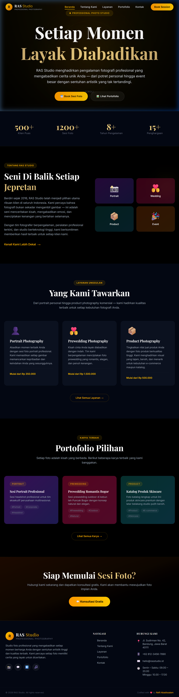
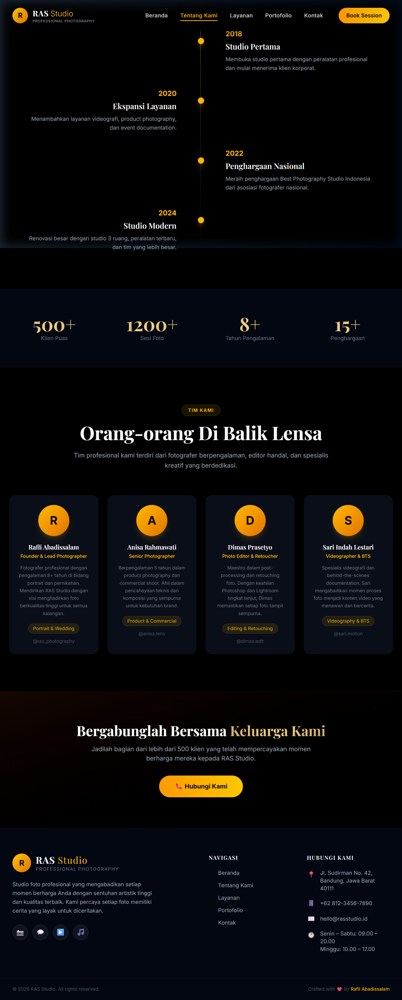
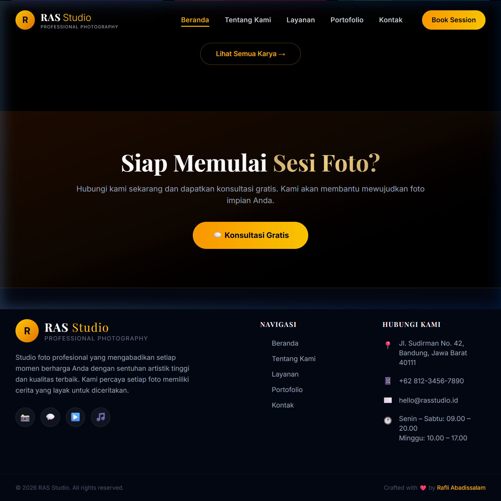
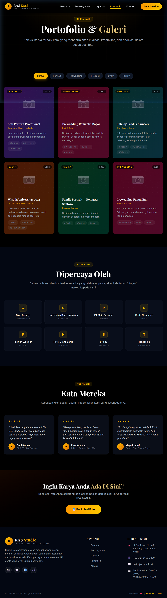
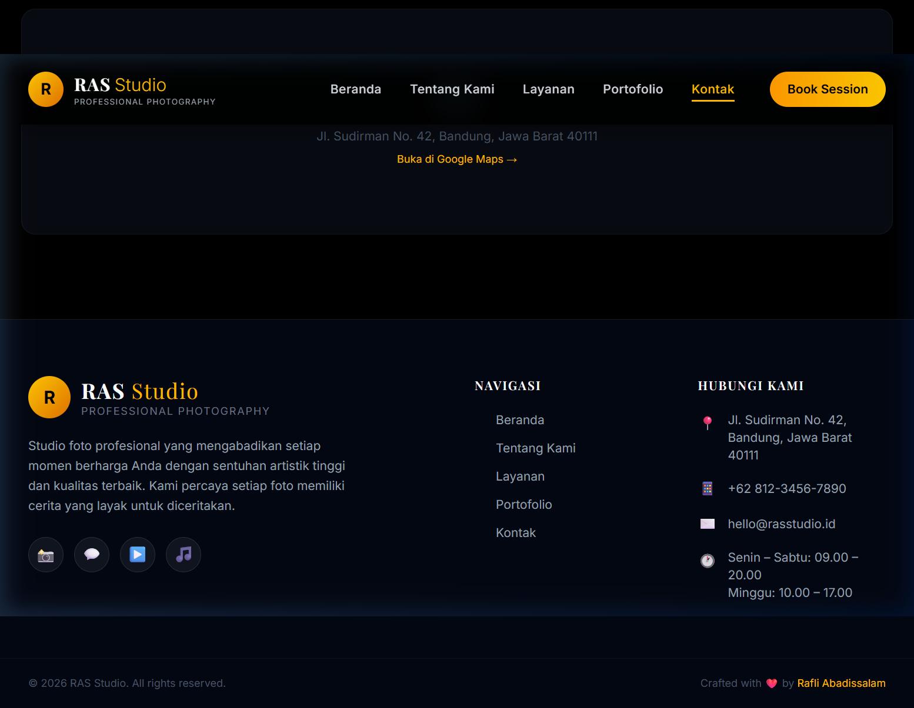

# RAS Studio — Company Profile Website

<div align="center">
  <h3>🎞️ Professional Photo Studio Website</h3>
  <p>Company profile website untuk RAS Studio, studio foto profesional yang mengabadikan setiap momen berharga.</p>
</div>

---

## 📋 Informasi Mahasiswa

| Field | Detail |
|-------|--------|
| **Nama** | Rafli Abadissalam |
| **NIM** | 2511074 |
| **Kelas** | Pilkom 3C |

---

## 📖 Deskripsi Website

**RAS Studio** adalah website company profile untuk studio foto profesional yang berlokasi di Bandung, Jawa Barat. Website ini menampilkan berbagai layanan fotografi, portofolio hasil kerja, profil tim, serta form kontak untuk pemesanan sesi foto.

### Fitur Utama:
- **5 halaman lengkap**: Beranda, Tentang Kami, Layanan, Portofolio, Kontak
- **Desain premium dark-mode** dengan tema emas (gold) yang elegan
- **Fully responsive** untuk desktop, tablet, dan mobile
- **Navigasi smooth** dengan React Router
- **Form kontak dengan validasi** (nama, email, pesan)
- **Filter portofolio** berdasarkan kategori
- **Animasi & hover effects** yang halus dan modern

---

## 🛠️ Teknologi

- **React** (dengan Vite)
- **Tailwind CSS v4** untuk styling
- **React Router DOM** untuk navigasi antar halaman
- **Google Fonts** (Playfair Display + Inter)

---

## 📁 Struktur Proyek

```
src/
├── components/
│   ├── Navbar.jsx        # Navigasi utama (sticky + responsive)
│   ├── Footer.jsx        # Footer dengan info kontak & sosial media
│   ├── Card.jsx          # Komponen card yang dapat digunakan ulang
│   └── SectionTitle.jsx  # Judul section yang dapat digunakan ulang
├── pages/
│   ├── Home.jsx          # Beranda
│   ├── About.jsx         # Tentang Kami
│   ├── Services.jsx      # Layanan
│   ├── Portfolio.jsx     # Portofolio & Galeri
│   └── Contact.jsx       # Kontak
├── data/
│   └── data.js           # Data konten (services, team, portfolio, clients)
├── App.jsx               # Root component dengan routing
├── main.jsx              # Entry point
└── index.css             # Global styles + Tailwind import
```

---

## 🚀 Cara Menjalankan Project

### Prasyarat
- Node.js versi 18+ sudah terinstall
- npm atau yarn

### Langkah-langkah

1. **Clone / download repository**
   ```bash
   git clone https://github.com/raflyascamp/company-project.git
   cd company-project
   ```

2. **Install dependencies**
   ```bash
   npm install
   ```

3. **Jalankan development server**
   ```bash
   npm run dev
   ```

4. **Buka di browser**
   ```
   http://localhost:5173
   ```

### Build untuk Production
```bash
npm run build
```

---

## 📄 Halaman Website

| Halaman | Path | Deskripsi |
|---------|------|-----------|
| Beranda | `/` | Hero section, statistik, highlight layanan & portofolio |
| Tentang Kami | `/about` | Visi misi, timeline sejarah, profil tim |
| Layanan | `/services` | Daftar lengkap layanan beserta harga & fitur |
| Portofolio | `/portfolio` | Galeri karya, daftar klien, testimoni |
| Kontak | `/contact` | Form kontak, info kontak, media sosial |

---

## 📸 Screenshot

### Beranda (Home)


### Tentang Kami (About)


### Layanan (Services)


### Portofolio


### Kontak


---

## 📞 Kontak RAS Studio

- 📍 Jl. Sudirman No. 42, Bandung, Jawa Barat 40111
- 📱 +62 812-3456-7890
- ✉️ hello@rasstudio.id
- 📸 Instagram: [@rasstudio](https://instagram.com/rasstudio)

---

<div align="center">
  <p>Made with ❤️ by <strong>Rafli Abadissalam</strong> — Pilkom 3C</p>
</div>
